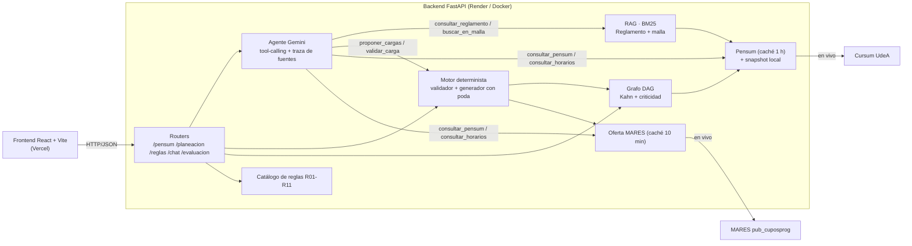

# PlaneAI — Evidencias para el informe final

Este directorio reúne lo que el informe final (formato IEEE) necesita para demostrar cada
compromiso del anteproyecto. Los archivos de `resultados/` se regeneran con los scripts de
`backend/scripts/`; no se editan a mano salvo las secciones marcadas para el equipo.

## 1. Estado frente a los objetivos del anteproyecto

| Objetivo | Indicador comprometido | Estado | Evidencia |
|---|---|---|---|
| **General** | Prototipo funcional desplegado y accesible en línea | ✅ Cumplido | Frontend https://plane-ai-udea.vercel.app · API https://planeai.onrender.com/docs |
| **OE1** Modelo computable del plan y del reglamento | 100 % de las materias modeladas, grafo acíclico, coincidencia ≥ 95 % con el plan publicado | ✅ Cumplido: 55/55 espacios y 168 créditos modelados, grafo acíclico, **96,4 %** de coincidencia por espacio (99,3 % por atributo) con el plan publicado (AF 868) | `resultados/oe1_modelo.md`, `GET /pensum/plan`, `GET /reglas`, `datos/cotejo_plan_publicado.csv` |
| **OE2** Motor de validación y recomendación | ≥ 25 casos, ≥ 90 % de propuestas cumple las restricciones duras | ✅ Cumplido: 25 casos; 51/51 propuestas (100 %) con oferta simulada y 49/49 (100 %) con la oferta real de MARES capturada el 18-nov-2026 | `resultados/oe2_motor.md`, `resultados/oe2_motor_oferta_real.md`, `datos/oferta_mares_2026-11-18.txt`, `resultados/cobertura.md` |
| **OE3** Interfaz conversacional con LLM + RAG | ≥ 85 % correctas en 40 preguntas, trazabilidad en todas | ✅ Cumplido (18-nov-2026, en producción): **38/40 correctas (95,0 %)**, 40/40 con la fuente esperada; latencia mediana 3,6 s | `resultados/oe3_banco.md`, `resultados/oe3_banco.csv` |
| **OE4** Evaluación con usuarios | SUS ≥ 68 con ≥ 15 estudiantes + hallazgos | 🟡 Pendiente: sesiones con estudiantes | `protocolo_evaluacion.md`; analizar con `scripts/analizar_sus.py` → `resultados/oe4_sus.md` |

## 2. Lo que falta y quién lo hace (equipo)

1. **Cotejo del plan (OE1).** Ya es automático contra el gráfico oficial del plan V.5 (AF 868), transcrito en
   `backend/app/data/plan_publicado_af868.json`. Conviene que alguien del equipo revise esa transcripción contra el PDF.
2. **Banco de 40 preguntas (OE3).** Hecho el 18-nov-2026 contra la API desplegada (`gemini-3.5-flash-lite`).
   La revisión humana quedó en la columna `correcta` de `resultados/oe3_banco.csv` (con su `observacion`);
   el equipo puede confirmarla en la app (**Evaluación → Banco de preguntas**). Para repetirlo:
   `python scripts/evaluar_asistente.py --api https://planeai.onrender.com` y luego `--resumen`.
3. **Sesiones SUS (OE4).** Aplicar `protocolo_evaluacion.md` a 15 o más estudiantes, exportar el CSV y
   correr `python scripts/analizar_sus.py planeai-sus.csv`. Completar la tabla de hallazgos y mejoras.
4. **Fase F1.** La encuesta (20 estudiantes) y las 5 entrevistas no se aplicaron; los requisitos salieron de la
   revisión documental. Los instrumentos quedan en los anexos A y B del protocolo.

## 3. Arquitectura (para la sección de diseño)



**Flujo de una pregunta.** El estudiante escribe → el agente decide qué herramienta usar → la herramienta
consulta la fuente (reglamento, malla, oferta o motor) y registra la fuente → el modelo redacta la respuesta
solo con lo recuperado y termina con la línea *Fuentes* → la API devuelve `respuesta`, `pasos` y `fuentes`
(con el artículo exacto del reglamento), que la interfaz muestra como enlaces.

**Restricciones duras del motor** (catálogo en `GET /reglas`): R01 materia del plan y no aprobada (art. 64),
R02 prerrequisitos (art. 42), R03 correquisitos (art. 43), R04 créditos aprobados mínimos (plan), R05 oferta,
grupo y cupo, R06 sin cruces (art. 68), R07 máximo 24 créditos (art. 66). Advertencias: R08 mínimo 8
(art. 67), R09 tiempo parcial (art. 66), R10 requisito de otra versión del plan, R11 grupo sin elegir.

## 4. Diferencias con el anteproyecto (para justificar en el informe)

| Anteproyecto | Implementado | Justificación |
|---|---|---|
| API en Node.js/Express + algoritmos en Python | Un solo backend en Python/FastAPI | Evita dos servicios y la serialización entre ellos; FastAPI da documentación OpenAPI automática (`/docs`). |
| PostgreSQL + índice vectorial | Sin base de datos: pensum y oferta en vivo con caché, y copia local del pensum | La oferta cambia minuto a minuto durante la matrícula; una ingesta quedaría obsoleta. La historia del estudiante se guarda en su navegador (privacidad). |
| RAG con embeddings | RAG con recuperación BM25 sobre el reglamento y la malla | Determinista, sin costo ni cuota de API y sin servicio externo en el plan gratuito; precisión verificada: el artículo esperado aparece en el top-4 en las 20 preguntas de reglamento (`tests/test_evaluacion.py`). La interfaz permite cambiar a embeddings. |
| React con TypeScript | React con JavaScript (Vite) | Velocidad de desarrollo del equipo; los contratos de datos se validan en el backend con Pydantic. |
| Despliegue con Docker | Render (Python nativo) + `backend/Dockerfile` y `docker-compose.yml` | El plan gratuito de Render no requiere imagen; el Dockerfile permite reproducir el entorno. |
| 54 materias, 156 créditos, 10 niveles | Plan V.5 (AF 868): 55 espacios y 168 créditos en 10 niveles = 44 obligatorias (128 créditos) + 11 espacios electivos (40 créditos), que se cursan con las 64 materias del banco de electivas de Cursum | Las cifras del anteproyecto son el plan sin la Práctica Académica (55 − 1 = 54 espacios; 168 − 12 = 156 créditos). En el informe conviene reportar las del plan completo (55 / 168 / 10), que coinciden con los "créditos para grado" de Cursum, y explicar la diferencia. |

## 5. Hallazgos técnicos de esta etapa (útiles para "resultados" y "lecciones")

- **Plan oficial vs. Cursum.** Cursum publica las obligatorias en 9 niveles y las electivas en un banco aparte
  (nivel 99); el plan oficial (AF 868) ubica 11 espacios electivos en los niveles 5, 7, 8, 9 y 10. El modelo
  une ambas vistas (`plan_service`) y llega a 55 espacios / 168 créditos / 10 niveles, igual que el plan.
- **Ajustes que Cursum no refleja.** Proyecto Integrador I exige 80 créditos aprobados (Lineamientos PI 2026-2,
  versiones 4 y 5) y no estaba en Cursum; se agregó como requisito. El código antiguo 2539101 (Lectoescritura)
  se trata como equivalente a Español Académico (2539130), que lo reemplazó en el mismo espacio.
- **Diferencias que quedan entre el plan publicado y Cursum** (decisión del equipo, ver cotejo): Cursum exige
  además Teoría de la Probabilidad y Colas para Lógica y Representación III, y la Cátedra de Formación
  Ciudadana (2517450) que reemplazó a Formación Ciudadana (2517362) ya no pide 40 créditos aprobados.

- **OE3: dónde falla el asistente.** Las dos respuestas incorrectas del banco (P10 y P16) fueron preguntas de
  agregación global ("¿de qué materia dependen más materias?", "¿cuántos cursos de inglés hay?") que ninguna
  herramienta respondía de forma directa: el modelo combinó resultados parciales y concluyó mal, aunque citó una
  fuente válida (trazabilidad no es lo mismo que corrección). Después de la medición se agregaron al índice de la
  malla dos documentos de agregación (`PE-CRITICAS`, `PE-INGLES`); no se cuentan en el indicador.
- **OE3: guardarraíl de herramientas (posterior a la medición).** En una conversación de prueba de varios turnos, el
  asistente propuso una carga sin llamar al motor (la interfaz la marcó «Respuesta sin consulta a fuentes oficiales»)
  y la carga incluía materias ya aprobadas y Proyecto Integrador I sin los 80 créditos. En una conversación nueva el
  mismo pedido sí pasa por el motor. Como protección, `_conversar` repite el turno con llamada obligatoria a
  herramientas (modo `ANY` de Gemini, solo en la primera llamada del bucle) cuando el modelo responde sin consultar
  ninguna; los saludos y agradecimientos quedan exentos. Pruebas en `tests/test_guardarrail.py`. No cambia el indicador.
- **OE3: precalificación automática.** Coincidió con la revisión humana en 37/40 preguntas; sus tres errores fueron
  falsos negativos por formato numérico (2.50 frente a 2.5) o paráfrasis ("una (1) habilitación").
- **RAG.** En las 20 preguntas de reglamento, BM25 trae el artículo esperado en la 1.ª posición en 17 y entre las
  4 primeras en 20 (MRR = 0,93), frente a MRR = 0,90 de una línea base TF-IDF con el mismo preprocesamiento.
- **Motor: tope de búsqueda.** Con más de ~20 materias candidatas (escenarios con electivas) el DFS llega al tope de
  20 000 nodos (≈ 0,2 s); con un tope 100 veces mayor el puntaje de las tres mejores cargas no cambia y el tiempo
  sube a ≈ 31 s. La mediana de generación en los 25 escenarios es 1,4 ms.
- **Requisitos por créditos.** Cursum marca algunos requisitos como `PRERREQCRED` (el "código" es un número de
  créditos: 16, 48, 60, 65 o 132). Antes se trataban como materias inexistentes y bloqueaban 22 materias,
  entre ellas todas las modalidades de grado; ahora se validan contra los créditos aprobados (regla R04).
- **Franja de la tarde.** El filtro aceptaba clases que empezaban en la tarde y terminaban de noche; el auditor
  independiente lo detectó y se corrigió (12:00–18:00 estricto).
- **Disponibilidad.** Si Cursum no responde, el backend usa la copia local del pensum (`origen_datos: snapshot`)
  en lugar de fallar.
- **Cuota y latencia del LLM (en producción).** Con Gemini 3.8 Flash en plan gratuito (5 solicitudes/min y
  20/día) el asistente tardaba más de 5 minutos o no respondía: el SDK reintentaba en silencio hasta 600 s por
  llamada. Se fijaron límites de tiempo (45 s por llamada, 15 s de reintentos), mensajes de error claros, un
  modelo de respaldo y se pasó a `gemini-3.5-flash-lite` (15/min y 500/día gratis), con `gemini-3.1-flash-lite`
  como respaldo (cuota independiente). Resultado medido en producción: respuestas en 2–3 s. Las preguntas
  sugeridas por IA quedaron apagadas (`SUGERENCIAS_IA`) para ahorrar una llamada por mensaje.
- **Indicador "sin conexión".** El borde de Render respondía 503 a `/health` cuando la consulta venía del
  navegador (en caché), aunque el servicio estaba arriba; la interfaz ahora consulta `/estado` (sin caché).

## 6. Cómo reproducir todo

```bash
cd backend
python -m venv .venv && source .venv/bin/activate && pip install -r requirements.txt
pytest -q --cov=app                         # 126 pruebas; cobertura en resultados/cobertura.md
python scripts/verificar_modelo.py          # OE1 (usa --snapshot sin conexión a la UdeA)
python scripts/banco_motor.py               # OE2 (--captura ../docs/datos/oferta_mares_2026-11-18.txt para la oferta real)
python scripts/evaluar_asistente.py --api https://planeai.onrender.com   # OE3
python scripts/analizar_sus.py planeai-sus.csv                           # OE4
```
