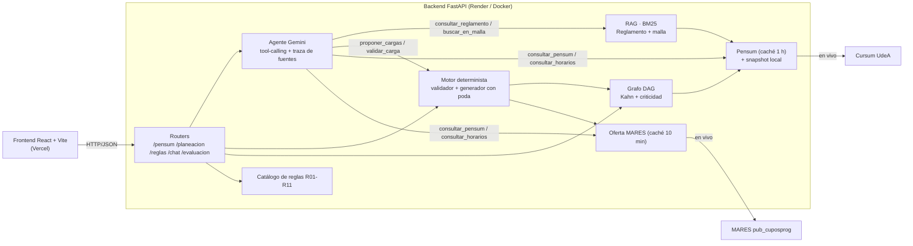

# PlaneAI — Evidencias para el informe final

Este directorio reúne lo que el informe final (formato IEEE) necesita para demostrar cada
compromiso del anteproyecto. Los archivos de `resultados/` se regeneran con los scripts de
`backend/scripts/`; no se editan a mano salvo las secciones marcadas para el equipo.

## 1. Estado frente a los objetivos del anteproyecto

| Objetivo | Indicador comprometido | Estado | Evidencia |
|---|---|---|---|
| **General** | Prototipo funcional desplegado y accesible en línea | ✅ Cumplido | Frontend https://plane-ai-udea.vercel.app · API https://planeai.onrender.com/docs |
| **OE1** Modelo computable del plan y del reglamento | 100 % de las materias modeladas, grafo acíclico, coincidencia ≥ 95 % con el plan publicado | ✅ Modelo y aciclicidad · ⏳ cotejo | `resultados/oe1_modelo.md`, catálogo de reglas `GET /reglas`, hoja `datos/cotejo_plan_publicado.csv` |
| **OE2** Motor de validación y recomendación | ≥ 25 casos, ≥ 90 % de propuestas cumple las restricciones duras | ✅ Cumplido: 25 casos, 51/51 propuestas (100 %) | `resultados/oe2_motor.md`, `resultados/cobertura.md` |
| **OE3** Interfaz conversacional con LLM + RAG | ≥ 85 % correctas en 40 preguntas, trazabilidad en todas | 🟡 Listo para medir | Banco `backend/app/data/banco_preguntas.json`; correr `scripts/evaluar_asistente.py` → `resultados/oe3_banco.md` |
| **OE4** Evaluación con usuarios | SUS ≥ 68 con ≥ 15 estudiantes + hallazgos | 🟡 Listo para aplicar | `protocolo_evaluacion.md`; analizar con `scripts/analizar_sus.py` → `resultados/oe4_sus.md` |

## 2. Lo que falta y quién lo hace (equipo)

1. **Cotejo del plan (OE1).** Abrir `datos/cotejo_plan_publicado.csv` y, materia por materia, marcar `sí`/`no`
   en `coincide` comparando contra el documento oficial del plan. Luego `python scripts/verificar_modelo.py`.
2. **Banco de 40 preguntas (OE3).** Después de desplegar esta versión:
   `python scripts/evaluar_asistente.py --api https://planeai.onrender.com` (≈ 10 min, usa cuota de Gemini;
   se puede reanudar con `--desde N`). Revisar la columna `correcta` de `resultados/oe3_banco.csv` contra
   `respuesta_esperada` y ejecutar `python scripts/evaluar_asistente.py --resumen`.
   También se puede hacer desde la app: **Evaluación → Banco de preguntas → Correr pendientes**.
3. **Sesiones SUS (OE4).** Aplicar `protocolo_evaluacion.md` a 15 o más estudiantes, exportar el CSV y
   correr `python scripts/analizar_sus.py planeai-sus.csv`. Completar la tabla de hallazgos y mejoras.
4. **Instrumentos de F1.** Si la encuesta (20 estudiantes) y las entrevistas (5) de la fase de análisis no
   quedaron documentadas, los instrumentos están en los anexos A y B del protocolo.

## 3. Arquitectura (para la sección de diseño)



**Flujo de una pregunta.** El estudiante escribe → el agente decide qué herramienta usar → la herramienta
consulta la fuente (reglamento, malla, oferta o motor) y registra la fuente → el modelo redacta la respuesta
solo con lo recuperado y termina con la línea *Fuentes* → la API devuelve `respuesta`, `pasos` y `fuentes`
(con el artículo exacto del reglamento), que la interfaz muestra como enlaces.

**Restricciones duras del motor** (catálogo en `GET /reglas`): R01 materia del plan y no aprobada (art. 64),
R02 prerrequisitos (art. 42), R03 correquisitos (art. 43), R04 créditos aprobados mínimos (plan), R05 oferta,
grupo y cupo, R06 sin cruces (art. 68), R07 máximo 24 créditos (art. 66). Advertencias: R08 mínimo 8
(art. 67), R09 tiempo parcial (art. 66), R10 requisito de otra versión del plan, R11 grupo sin elegir.

## 4. Diferencias con el anteproyecto (para justificar en el informe)

| Anteproyecto | Implementado | Justificación |
|---|---|---|
| API en Node.js/Express + algoritmos en Python | Un solo backend en Python/FastAPI | Evita dos servicios y la serialización entre ellos; FastAPI da documentación OpenAPI automática (`/docs`). |
| PostgreSQL + índice vectorial | Sin base de datos: pensum y oferta en vivo con caché, y copia local del pensum | La oferta cambia minuto a minuto durante la matrícula; una ingesta quedaría obsoleta. La historia del estudiante se guarda en su navegador (privacidad). |
| RAG con embeddings | RAG con recuperación BM25 sobre el reglamento y la malla | Determinista, sin costo ni cuota de API y sin servicio externo en el plan gratuito; precisión verificada: el artículo esperado aparece en el top-4 en las 20 preguntas de reglamento (`tests/test_evaluacion.py`). La interfaz permite cambiar a embeddings. |
| React con TypeScript | React con JavaScript (Vite) | Velocidad de desarrollo del equipo; los contratos de datos se validan en el backend con Pydantic. |
| Despliegue con Docker | Render (Python nativo) + `backend/Dockerfile` y `docker-compose.yml` | El plan gratuito de Render no requiere imagen; el Dockerfile permite reproducir el entorno. |
| 54 materias, 156 créditos, 10 niveles | Cursum versión 5: 44 obligatorias (128 créditos) en 9 niveles + 64 electivas y modalidades de grado (12 créditos, exigen 132 aprobados) | Las cifras del anteproyecto incluyen los espacios electivos y la modalidad de grado como "materias". **Decidir en el informe** qué cifra se reporta y explicar la equivalencia; el modelo cubre el 100 % de las 108 materias que publica el sistema oficial. |

## 5. Hallazgos técnicos de esta etapa (útiles para "resultados" y "lecciones")

- **Requisitos por créditos.** Cursum marca algunos requisitos como `PRERREQCRED` (el "código" es un número de
  créditos: 16, 48, 60, 65 o 132). Antes se trataban como materias inexistentes y bloqueaban 22 materias,
  entre ellas todas las modalidades de grado; ahora se validan contra los créditos aprobados (regla R04).
- **Franja de la tarde.** El filtro aceptaba clases que empezaban en la tarde y terminaban de noche; el auditor
  independiente lo detectó y se corrigió (12:00–18:00 estricto).
- **Disponibilidad.** Si Cursum no responde, el backend usa la copia local del pensum (`origen_datos: snapshot`)
  en lugar de fallar.

## 6. Cómo reproducir todo

```bash
cd backend
python -m venv .venv && source .venv/bin/activate && pip install -r requirements.txt
pytest -q --cov=app                         # 91 pruebas; cobertura en resultados/cobertura.md
python scripts/verificar_modelo.py          # OE1 (usa --snapshot sin conexión a la UdeA)
python scripts/banco_motor.py               # OE2 (--vivo para la oferta real)
python scripts/evaluar_asistente.py --api https://planeai.onrender.com   # OE3
python scripts/analizar_sus.py planeai-sus.csv                           # OE4
```
